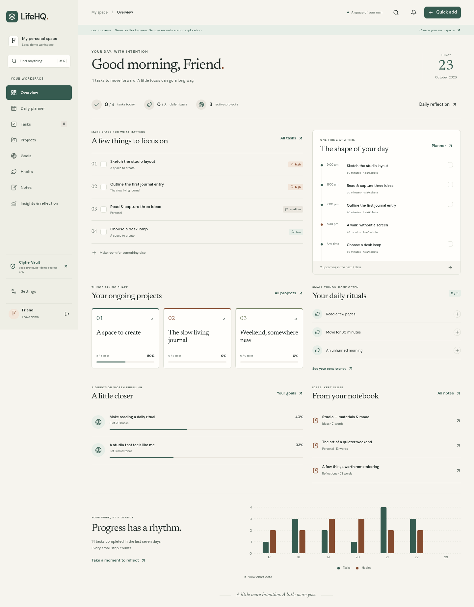

# LifeHQ + CipherVault

An editorial personal workspace and an independently isolated, encrypted local vault prototype. Built with Next.js App Router, strict TypeScript, React, Tailwind, customized Radix/shadcn-style primitives, Lucide, Recharts, and Supabase. No LLM or paid AI API is required.

**CipherVault is not independently audited. Use dummy credentials only. It is unsuitable for real credentials until expert review.**

LifeHQ is deployed at **https://lifehq-three.vercel.app** ([demo](https://lifehq-three.vercel.app/demo)). The hosted login/demo responses and protected-route denial were checked through the Vercel connector. Full hosted authentication acceptance remains open. Source: [IntelliCoder-AI/LifeHQ-and-CipherVault](https://github.com/IntelliCoder-AI/LifeHQ-and-CipherVault).

## Run locally

Use Node.js 22 or 24 and npm. From the repository root:

```sh
npm ci
cp .env.example apps/lifehq/.env.local
```

Set the Supabase project URL and **publishable** key in that file. Follow [DEPLOYMENT.md](DEPLOYMENT.md) to apply migrations and configure authentication. Never use a service-role key in either app. Without Supabase configuration, the explicitly labeled `/demo` workspace still works locally; account access is disabled.

Run in two terminals:

```sh
npm run dev          # LifeHQ: http://localhost:3000
npm run dev:vault    # CipherVault: http://localhost:3001
```

Open `/login` to create an account, or `/demo` to explore an empty local workspace. “Explore sample workspace” loads clearly labeled sample records **only into your browser**. Account workspaces start empty. The two apps must keep different origins; never embed the vault in LifeHQ or place them under paths on one origin.

The always-visible CipherVault entry opens its standalone product page and launches the separate web app. CipherVault can also run locally using the command above. Its web hosting delivers the interface; encrypted records stay in your browser. CipherVault needs no environment variables or account. Create a dummy master passphrase, acknowledge the prototype warning, and add test items. Keep an encrypted backup: clearing browser storage, losing the passphrase, or losing the device can permanently lose the local vault.

## What is implemented

- Overview with saved-data summaries, priorities, schedule, deadlines, goals, habits, notes, and reorderable sections. Settings → Customize Overview controls their visibility and order after saving.
- Tasks with checklists, tags, categories, filters, bulk status, list/board views, recurrence, and completed occurrence history.
- Day/week/month planning, time blocks, per-occurrence moves and cancellations, keyboard-accessible date editing, and project deadlines.
- Projects and milestones; measurable goals and linked actions; dated habit histories and deterministic streaks.
- Markdown notes with autosave, folders, tags, favorites, pins, duplication, import/export, and safe preview.
- Analytics, daily/weekly reflections, command search, header theme toggles, system appearance, preferences, data export, and confirmed account deletion.
- Signup password confirmation and a Show passwords checkbox; Supabase cookie sessions, server validation, version conflict checks, owner RLS, and same-owner foreign keys.
- Local Argon2id/AES-256-GCM vault, generator, locking, encrypted backup/restore, and passphrase re-encryption.

See [FEATURES.md](FEATURES.md) for behavior and limitations. The full acceptance goal remains open until hosted authentication and persisted account journeys are verified; passing local-demo tests does not prove hosted Auth works.

## Verify and build

```sh
npm run typecheck
npm run lint
npm test
npx playwright install --with-deps chromium
npm run test:e2e
npm run build
```

Playwright uses `/usr/bin/chromium` when installed, otherwise its bundled Chromium. Override with `PLAYWRIGHT_CHROMIUM_EXECUTABLE` if needed. It starts both development servers unless `E2E_EXTERNAL=1`. See [TESTING.md](TESTING.md) for production-server commands and the exact scope of verification.

## Project map

```text
apps/lifehq/          Next.js UI, cookie-auth API routes, Supabase boundary
apps/ciphervault/     Separate Next.js origin, browser crypto and IndexedDB
packages/ui/         Design tokens and accessible visual primitives
packages/shared/     Nonsensitive schemas, recurrence, progress calculations
supabase/migrations/ PostgreSQL ownership, RLS, constraints, integrity triggers
tests/               Domain, crypto, React, PostgreSQL and browser checks
docs/screenshots/    Captured running interfaces; sample/dummy records only
```

Further documentation: [Architecture](ARCHITECTURE.md), [Design system](DESIGN_SYSTEM.md), [Security](SECURITY.md), [Deployment](DEPLOYMENT.md), [Verification](TESTING.md), and [implementation status](docs/IMPLEMENTATION.md).

## Screenshots



[Mobile tasks](docs/screenshots/tasks-390.png) · [Note editor](docs/screenshots/note-editor-1440.png) · [Project board](docs/screenshots/project-board-1440.png) · [Dark theme](docs/screenshots/overview-dark-1440.png) · [Vault dummy item](docs/screenshots/vault-detail-1440.png) · [Planner](docs/screenshots/planner-1440.png) · [Goals](docs/screenshots/goals-1440.png) · [Habits](docs/screenshots/habits-390.png) · [CipherVault setup](docs/screenshots/vault-setup-1440.png)

CipherVault interface: https://ciphervault-orpin.vercel.app — a separate browser-local prototype. The production root returned HTTP 200 through the Vercel connector, with its restrictive CSP and prototype label. This does not establish an independent crypto audit or complete hosted browser verification.
